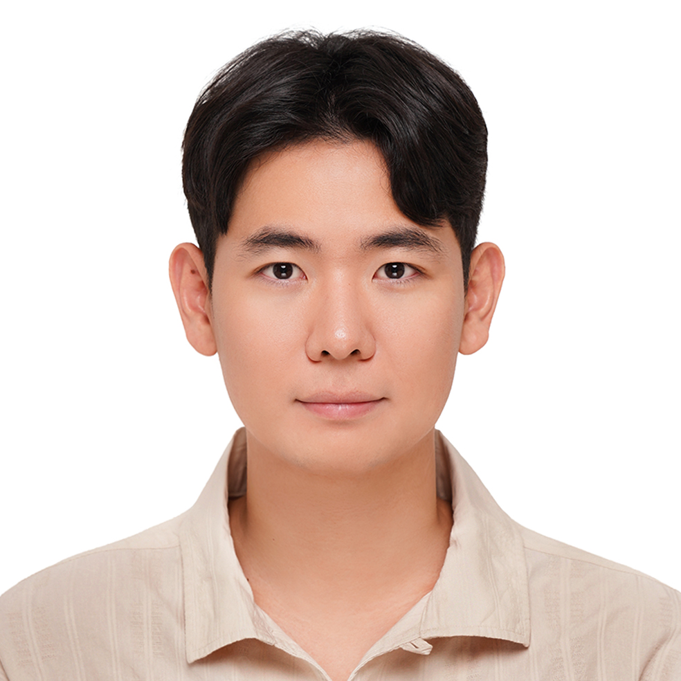

  

    <h1>Changsuk Oh</h1>

    
Postdoctoral Scholar

    

      Department of Radiological Sciences 
      University of California, Los Angeles
    

    

      <a href="https://scholar.google.com/citations?user=YOUR_ID"
         target="_blank" rel="noopener noreferrer">
        🎓 Google Scholar
      </a>

      <a href="/files/CV.pdf"
         target="_blank" rel="noopener noreferrer">
        📄 Curriculum Vitae
      </a>
    

  

  

    
  

I am a postdoctoral researcher at UCLA.
My research focuses on medical image analysis,
generative AI, and machine learning for healthcare.

## News

- [Nov. 2026] My personal website is launched.
- [Oct. 2026] A new paper was accepted.

## Research Interests

- Medical Image Analysis
- Generative AI
- Computer Vision

## Publications

**Paper Title 1**  
Author 1, Author 2, Your Name  
*Journal Name*, 2026.

[Paper](https://arxiv.org/)
